# Dérive

*La dérive* is the Parisian art of drifting through a city, letting the
streets lead you.  Dérive is an open-world driving (and flying, and
walking) game in Ada and GtkAda.  The 3D city of
Paris (inside the Périphérique, plus the Bois de Boulogne, Vincennes and a
corner of La Défense) is generated from OpenStreetMap data: buildings with their
real outlines, heights and roofs, streets with markings and traffic
lights, the Seine with its quays and bridges, trees, street lamps, traffic
and pedestrians, day and night, and rain.

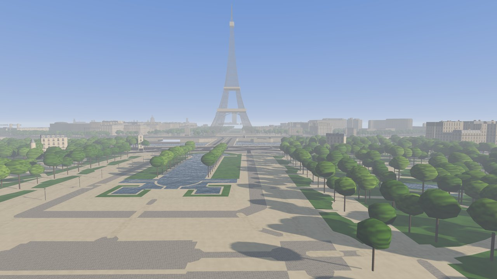

## Screenshots

| | |
|---|---|
| 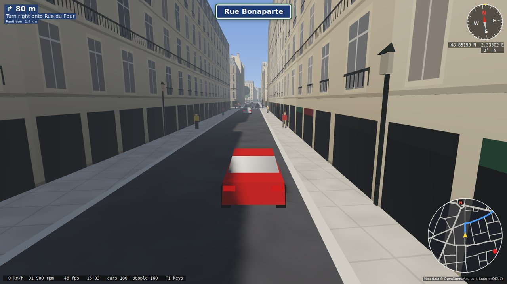 | 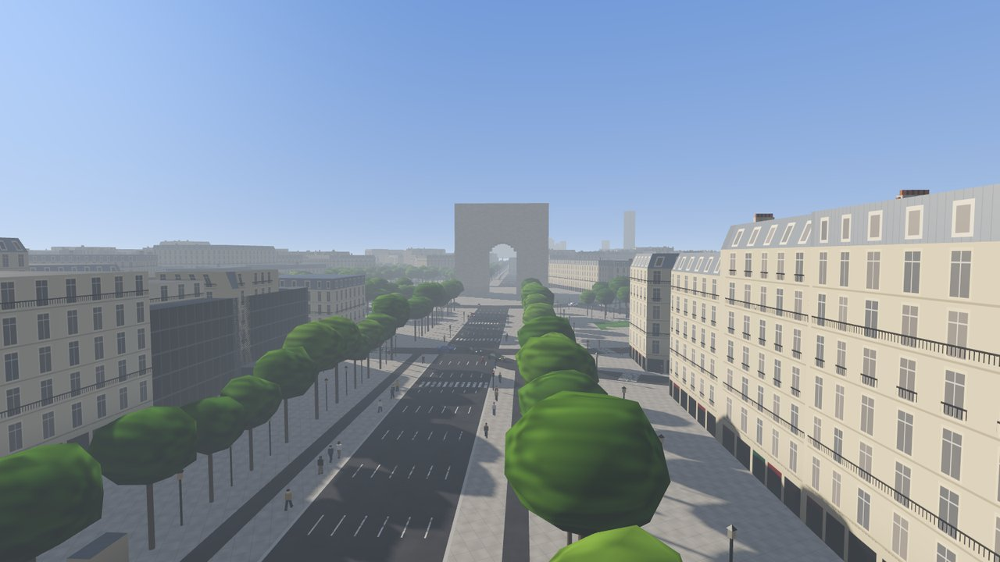 |
| Driving with the GPS: turn-by-turn directions, compass and minimap | The Champs-Élysées and the Arc de Triomphe |
| 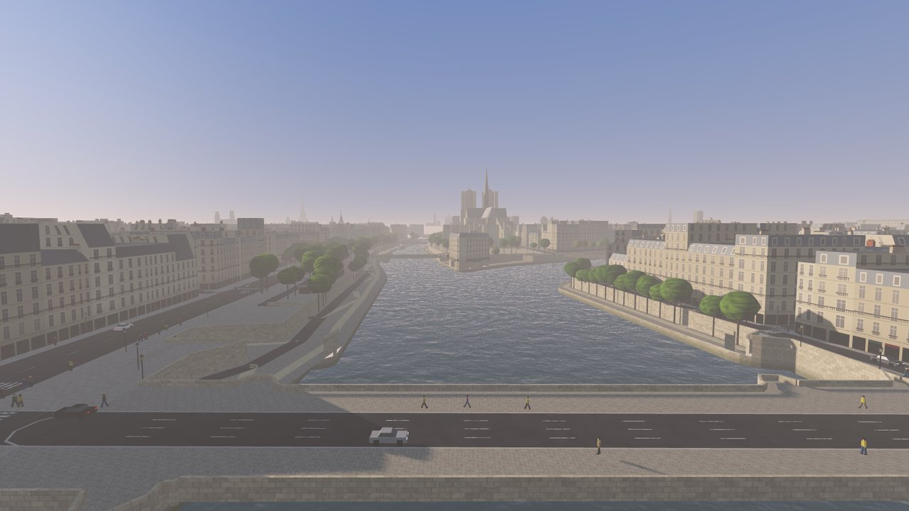 | 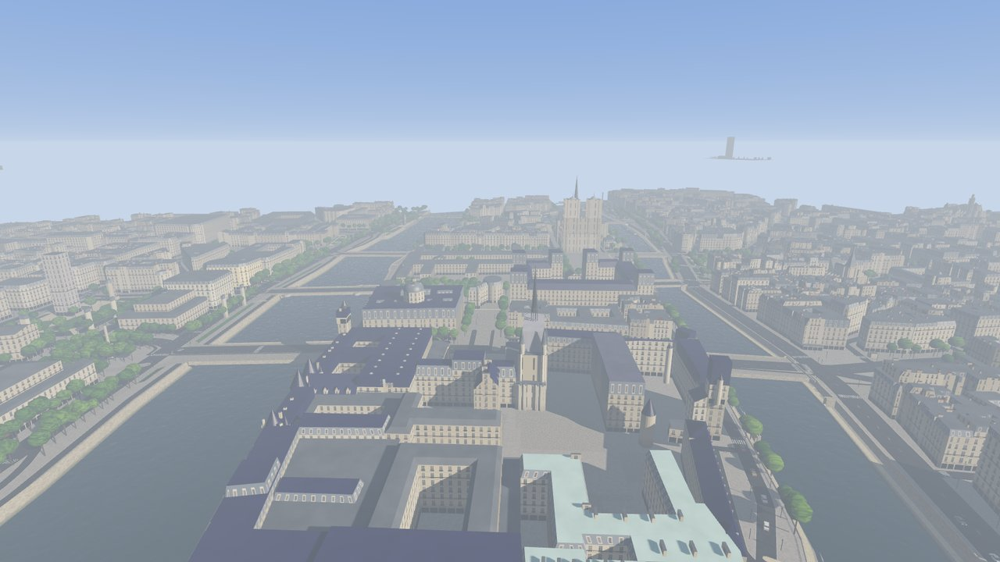 |
| The Seine and Notre-Dame at sunset | The Île de la Cité and Sainte-Chapelle from above |
| 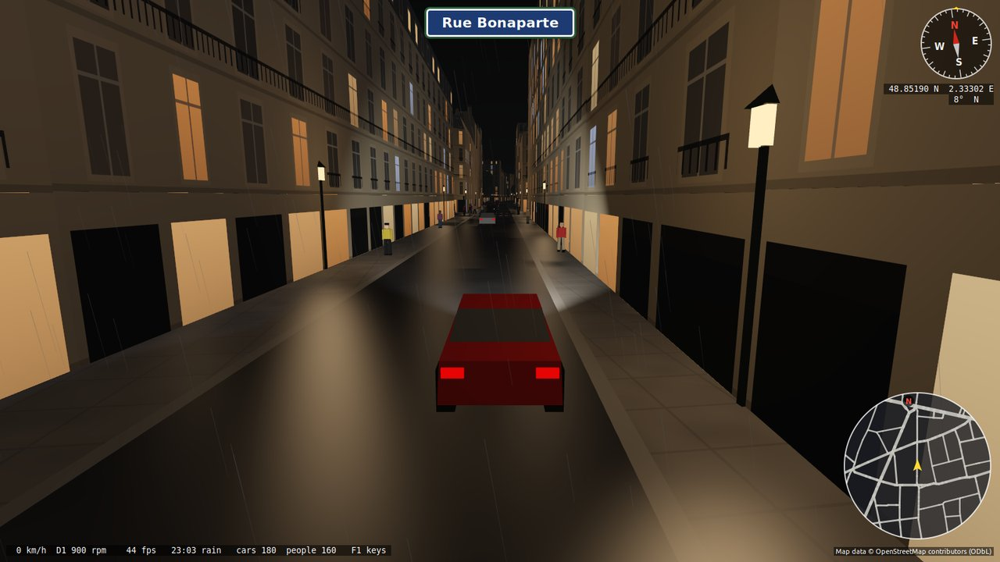 | 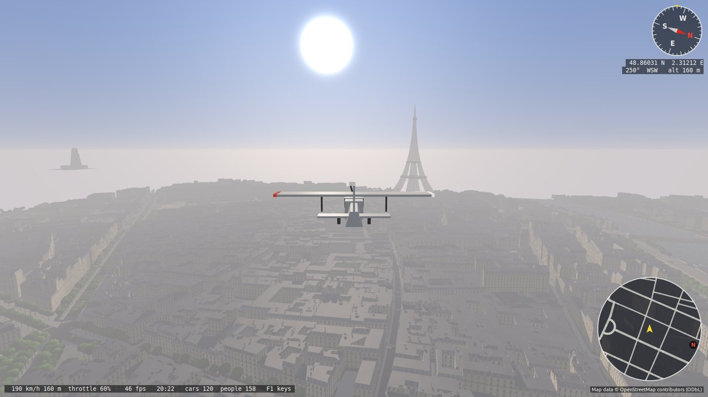 |
| A rainy night near Saint-Sulpice | Flying towards the Eiffel Tower |
| 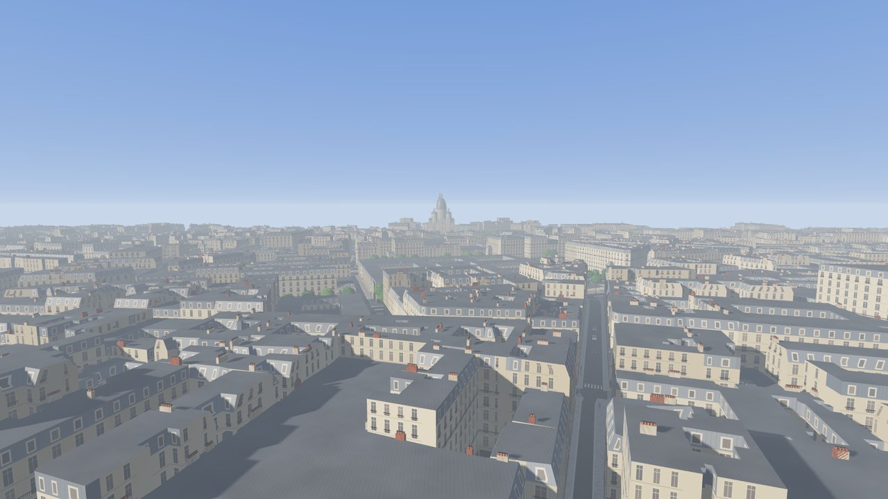 | 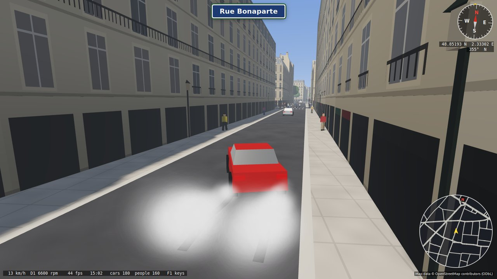 |
| The rooftops, towards Montmartre | Drop the clutch: smoke and skid marks |
| 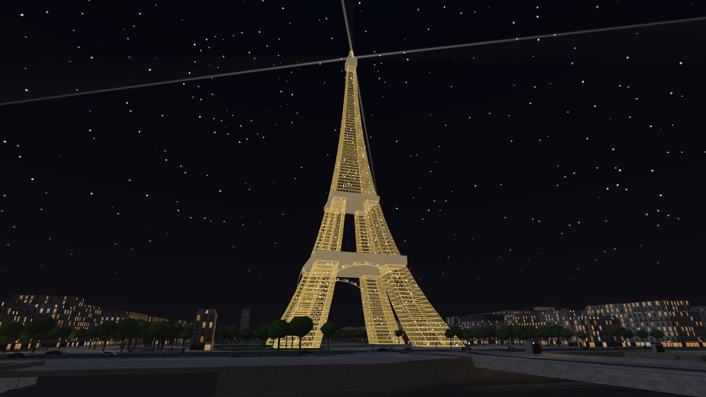 | 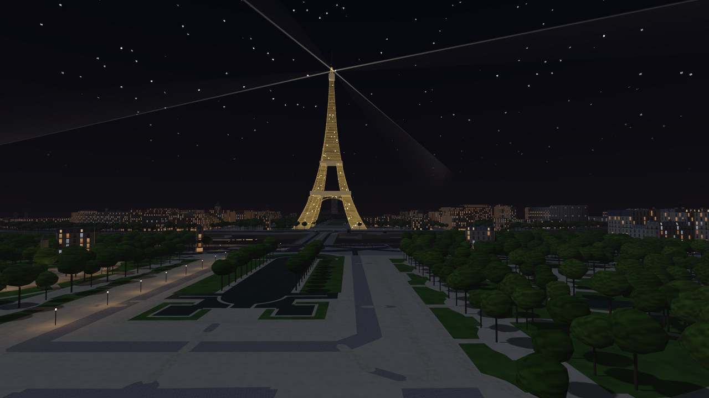 |
| On the hour after dark the Eiffel Tower sparkles for five minutes | The beacon on top sweeps its beams over Paris until 23:45 |

## Written entirely by prompting

This project started as a test of what Claude Code can do.  Every line of
code, shader, script and documentation here was written by Claude (the
Claude Opus 5.5 model, `claude-opus-5-5`, in Claude Code) from the author's
prompts; the author has not written or edited a single line of code by
hand.  The idea is to see how far one can get by describing, looking and
giving feedback only: "drive me around Saint-Sulpice", "the traffic lights
stand in the middle of the road", "the bells should be a little deeper",
"the background sounds like ocean waves".

The work happened in conversation: Claude wrote and built the code, checked
the result with screenshots and recordings it made itself, and the author
played the game and said what to change next.

Claude had access to all the authors existing Ada projects for inspiration how to 
structure the project, build setup, libraries to use, documentation layout, et cetera.

## Building

Dérive runs on Linux.  It needs:

- **GNAT** (the Ada compiler, version 10 or newer) and **gprbuild**
- **GtkAda** (the Ada binding to GTK 3) and **GTK 3**
- **libepoxy** (OpenGL), **zlib**, **PulseAudio**'s libpulse-simple
- **curl**, to download the map data and the ground heights
- a graphics card with **OpenGL 3.3**
- **ffmpeg** (optional), to record videos with F9

`make` first checks that all of these are there.  If something is missing
it says what, gives the command to install it, and offers to run it.
`make check` does only the check.  The packages:

| | |
|---|---|
| Debian, Ubuntu, Mint | `sudo apt install gnat gprbuild libgtkada-dev libgtk-3-dev libepoxy-dev zlib1g-dev libpulse-dev pkg-config curl ffmpeg` (the GtkAda package is called `libgtkada20-dev` or similar on some releases) |
| Fedora | `sudo dnf install gcc-gnat gprbuild gtkada-devel gtk3-devel libepoxy-devel zlib-devel pulseaudio-libs-devel pkgconf curl ffmpeg-free` |
| Arch | `sudo pacman -S gcc-ada gprbuild gtk3 libepoxy zlib libpulse pkgconf curl ffmpeg`, and `gtkada` from the AUR |
| openSUSE | `sudo zypper install gcc-ada gprbuild gtkada-devel gtk3-devel libepoxy-devel zlib-devel libpulse-devel pkg-config curl ffmpeg` |

Then:

    make            # check, build the converter (bin/osm2tiles) and the game (bin/derive)
    make tiles      # download the map data and the ground heights, build tiles/
    make run        # play

Building the city the first time downloads a few hundred MB and takes a
while; the tiles take about 800 MB.

The OSM data (`data/osm/`), the ground heights (`data/elevation/`) and
the generated tiles are not in the repository; `make tiles` recreates
them.  The map area (`BBOX` in the
Makefile) is split into 2 x 2 km chunks which are downloaded one after the
other from the Overpass API (`scripts/build_city.sh`, query in
`data/query.overpassql`) and converted in parallel.  An interrupted
download simply continues where it stopped when run again; `make download`
fetches everything fresh.  Change `BBOX` to build a smaller or larger area.

## Controls

| Key | |
|---|---|
| arrows / WASD | drive |
| space | handbrake |
| B | horn |
| Q | get out and walk (mouse to look all round, W/A/S/D to walk, Shift to run); Q again by the car to drive on |
| E | gearbox: manual (with the wheel's shifter and clutch) or automatic |
| I | instruments: the gear (H-pattern or R N D), rev counter, speed and pedals |
| L | save the place where you are |
| O | saved places: navigate there with the GPS, or go there |
| C | chase or drone camera |
| mouse wheel, + / - | zoom |
| F | take off in a plane / land and drive again |
| W / S, arrows (in the air) | throttle, pitch (up = nose down) and bank |
| T | one hour later |
| P | weather: rain, thunderstorm, snow, dry again |
| N | street names |
| G | compass, position (lat/lon, heading, altitude) and minimap |
| Shift + 1 .. 0 | GPS: navigate to that place (route through the real streets, turn-by-turn with street names) |
| X | stop navigating |
| J | clear the traffic around you (new cars arrive gradually) |
| M | sound on/off |
| 1 .. 9, 0 | jump to Saint-Sulpice, Notre-Dame, Louvre, Tour Eiffel, Arc de Triomphe, Sacré-Cœur, Panthéon, Concorde, Opéra, Bastille |
| H | home: Place Saint-Sulpice (also where the game starts) |
| R | reset |
| F9 | record a video with sound; F9 again stops (saved in `~/Videos/Derive`) |
| F12 | take a photo (saved in `~/Pictures/Derive`) |
| F1 | show these keys in the game |

### Racing wheel

A Logitech G29 (with its pedals and the Driving Force H-shifter) is found
by itself when it is plugged in, also while the game runs.  It is read
straight from the Linux event device, no extra libraries.  You drive with
a manual six-speed gearbox: the gear only goes in with the clutch down
(otherwise it grinds), first gear creeps at idle, and the engine does not
stall; E switches to an automatic gearbox.  Drop the clutch at high revs
(or, in the automatic, hold the brake and floor the throttle, then let go
of the brake) and the rear wheels spin, smoke and leave black marks; so do
locked brakes and fast corners, and the tyres squeal.  Force feedback pulls the wheel back to the centre more the faster
you go and kicks over kerbs and in crashes.

| Wheel | |
|---|---|
| X | handbrake |
| square | camera |
| triangle | compass and minimap |
| circle | street names |
| R2 / L2 | one hour later / weather |
| share | clear the traffic |
| options | sound on/off |
| PS | home |
| enter (in the red dial) | horn |
| L3 | stop navigating |
| d-pad right / left | save this place / saved places |
| + / - and turning the red dial | zoom |

The plane is flown with the keyboard.

### Saved places

L saves the place where you are (named after the street) and O lists the
saved places: Enter sets the GPS to it, Space takes you there, Delete
forgets it.  They are kept in `~/.derive_places`, one per line as
`latitude longitude name`, so the names can be changed there.  Saved
places show as green diamonds on the minimap.

### The calendar and its surprises

The game runs on today's date: the sun rises and sets as it does in Paris
in that season, the moon shows its real phase, the trees change with the
year, and the clock carries on into the next day at midnight.

Paris celebrates its days, and the game knows them: holidays, festivals,
the seasons and the evenings before them all bring something to see and
hear.  Other things happen at random, by day or at night, now and then or
only rarely.  None of them is listed here; drive around, look up at the
sky, listen, and come back on a special day.

To play on another day, put it in `~/.deriverc`:

    date = 2026-12-24

or start the game with `PARIS_DATE=2026-12-24 ./bin/derive`.  `date =
today` goes back to the real date.  Together with `start_hour` (and **T**
in the game for one hour later) you can be in Paris on any day at any
time.

## Settings

`~/.deriverc` holds settings as `name = value` lines (`#` starts a
comment); the game writes a commented starter file on its first run.
So far: `traffic`, `pedestrians` (1.0 = normal), `volume` (0 .. 1),
`start_hour`, `time_speed` (game minutes per real second), `compass`,
`street_names` and `instruments` (yes/no), `date` (`today` or e.g.
`2026-12-24`), `christmas` and `halloween` (auto/yes/no), `car`
(`modern`, `2cv` or `ds`), and for the wheel `manual_gearbox` (no:
automatic), `clutch` (no: change gear without the clutch) and
`force_feedback` (0 .. 1), `steering` (sensitivity) and `wheel_centre`
(degrees).

## How it works

- `src/tools`: `osm2tiles` reads the OSM extract and writes 250 m tiles
  (meshes, collision edges, lamps, road strips) and the road network.
- `src/game`: the GtkAda game; tiles are streamed around the player.
- `shaders`: facades, windows, roofs, water and lighting are drawn
  procedurally in GLSL, there are no textures.

`data/` holds a few hand-made details that `osm2tiles` adds to the
OpenStreetMap data.

Debug options for screenshots: `PARIS_SHOT=file.ppm`, `PARIS_SPAWN`,
`PARIS_CAM`, `PARIS_DRONE`, `PARIS_FLY`, `PARIS_TIME`, `PARIS_RAIN`,
`PARIS_ZOOM`, `PARIS_TILES`, `PARIS_TELEPORT`, `PARIS_WAV`, `PARIS_COMPASS_PNG`, `PARIS_HELP_PNG`, `PARIS_LIST_PNG`, `PARIS_RECORD`, `PARIS_DATE`, `PARIS_FIREWORKS`, `PARIS_STRIKE`, `PARIS_SANTA`, `PARIS_GHOST`, `PARIS_UFO`, `PARIS_PEAL`, `PARIS_FREEZE`, `PARIS_SURPRISE`, `PARIS_WALK`, `PARIS_ORBIT`, `PARIS_SHOT_PNG` (with the overlays), `PARIS_BURNOUT`, `PARIS_NOWHEEL`, `PARIS_NAV`, `PARIS_MAP_PNG`, `PARIS_PROFILE` (see `src/game/game.adb`).

## License

The code is released under the MIT License (see `LICENSE`).  The polygon
triangulation in `src/tools/earcut.*` is a port of Mapbox's earcut and
keeps its ISC License (in those files).

The map data is not part of this repository: it is downloaded from
OpenStreetMap when you build the city.  Map data © OpenStreetMap
contributors, available under the Open Database License (ODbL); the game
shows this credit on screen.  The ground heights (the hills of Montmartre,
Belleville and the Montagne Sainte-Geneviève) come from IGN's RGE ALTI,
© IGN, under the Licence Ouverte 2.0, also downloaded when you build.
